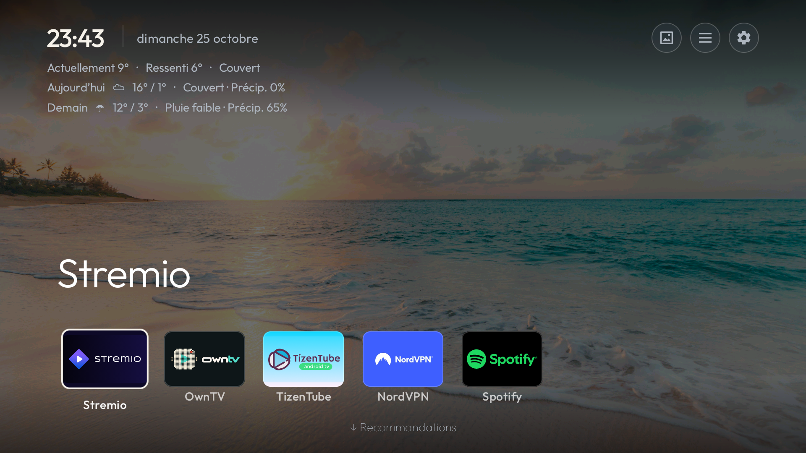
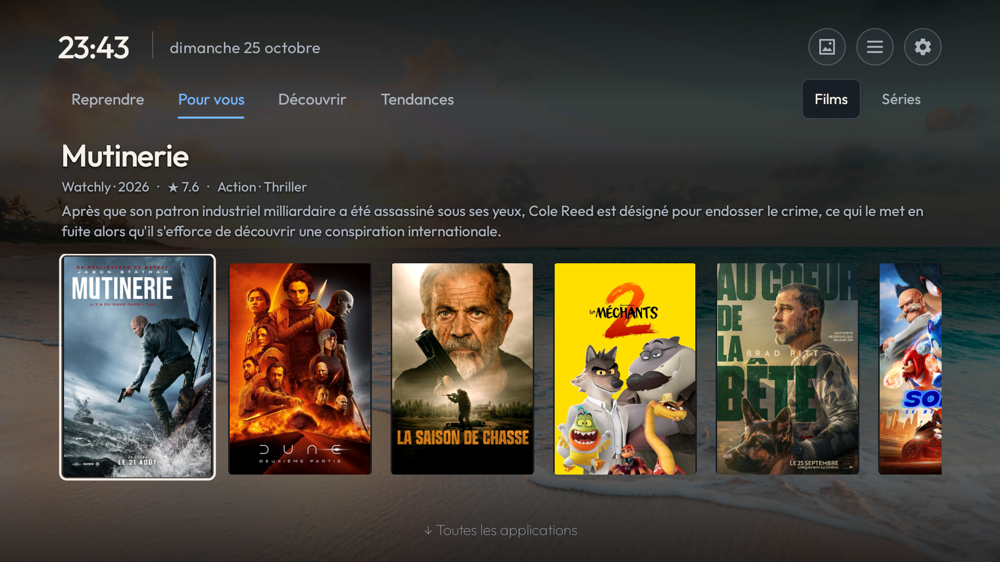
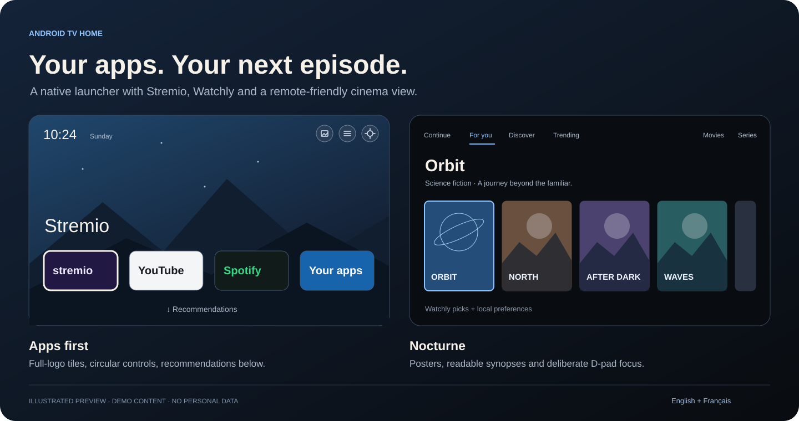
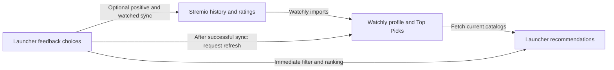

# Neovia

**Your apps. Your next episode. Your next discovery.**

<p align="center">
  
</p>

<p align="center"><strong>Native Java · Android TV 8+ · English &amp; French · Optional account connections · No telemetry</strong></p>

Neovia is a personal Android TV launcher that brings your favorite apps, Stremio viewing progress and
personalized film and series recommendations onto Home. It also includes **reversible TV debloat tools**,
with backups, tested device lists and restore support. Built on
[CleanYourTV by Gathin23 and contributors](https://github.com/Gathin23/cleanyourtv),
with a cinema interface designed for remote navigation and optional **apps-first Home**.

[Install and connect accounts](PERSONALIZATION.md#build-and-try-the-launcher) ·
[Watchly setup](docs/watchly.md) ·
[Debloat and restore](#debloat-back-up-and-restore) ·
[Themes and options](themes/README.md) ·
[Documentation](docs/README.md) ·
[Contributing](CONTRIBUTING.md)

## Why Neovia

I started with CleanYourTV's native launcher and reversible TV cleanup tools, then adapted the
launcher for how I use my own TV: open my favorite apps, pick up a Stremio episode, or find
something to watch without digging through several apps.

My changes bring Stremio and Watchly into Home, add local viewing preferences, and give the interface
a cinema layout that works with a remote. I also added an apps-first layout, so the main screen
can stay focused on favorite apps and a wallpaper, with recommendations one Down press away.
The original launcher, TV lists, themes and cleanup tools remain part of the project.

## Two ways to use Home

| Apps first | Cinema catalog layout |
|---|---|
| Favorite apps on the main screen; press **Down** for recommendations, then use **All applications** for the other apps. | Title details, synopses and recommendations above the app dock, on a solid background. |
| Rounded full-logo app tiles, compact circular header buttons and an optional wallpaper. | Large posters, blue source indicators and side menus; hold OK for the full synopsis. |

Apps, recommendations and wallpaper depend on your own setup. Both layouts are optional; see
[customization](PERSONALIZATION.md#customize) and the [cinema theme](themes/nocturne/config.json).

## Screenshots from a real TV

The Home screenshot above and the recommendations page below were captured on an **onn Streaming
Device 4K Pro running Android TV 12**. The header controls line up with the clock and date. Home
shows current and feels-like temperatures plus today's and tomorrow's forecasts; weather disappears
on the recommendations page to leave more room for title details and larger posters.



The captures contain app logos and film artwork, with no account identifiers, location labels or
network details. The beach wallpaper comes from [Unsplash](https://images.unsplash.com/photo-1507525428034-b723cf961d3e).
App logos and film artwork belong to their respective owners.

<details>
<summary>Illustration of both optional layouts</summary>



This illustration uses demo content. The screenshots above show the actual apps-first interface.

</details>

## What makes Neovia personal

- **Stremio Continue and Coming next.** Connect by QR code, see films and episodes in progress,
  check remaining time, and open the exact episode in Stremio. A separate view lists dated upcoming
  episodes when metadata is available.
- **Recommendation years.** For you and Trending show the current release year and two previous
  years (2024–2026 in 2026). Discover uses the same window by default; its menu can explicitly enable
  all years. For you also respects Watchly's configured range. Series use their premiere year.
- **Personalized discovery.** Read your Watchly ElfHosted Top Picks catalogs, filter known
  watched titles, and refine ordering with local positive viewing preferences. Public Cinemeta
  catalogs provide discovery and trending views alongside the private Watchly feed.
- **Watched and liked in one choice.** Hold OK on a poster to mark a film watched and liked, or a series
  finished and liked. The title disappears from suggestions and contributes one explicit positive
  preference. Optional Stremio sync sends both the watched mark and a Liked rating, then requests a
  Watchly refresh. Separate watched, More like this and Not interested choices remain available.
- **The cinema interface.** Large posters, readable title details and available synopses, clear
  focus, blue source indicators and side menus. Title artwork stays in the poster strip; the optional
  apps-first layout can use a wallpaper behind its content.
- **Home organized into three levels.** With apps-first enabled, move from favorite apps to
  recommendations to the remaining-app grid. Up, Back and Home provide a route back. Films and Series
  change on click or OK; moving focus between those two buttons keeps the current category.
- **Keep your place while browsing.** Returning from a Stremio title restores its recommendations
  page and selected title. After a successful feedback choice, focus advances to the next title from
  the original list, even if ranking changes. At the end of the list it falls back to the previous
  title, or the nearest remaining position if that title also disappears.
- **Controls for everyday use.** A remote-editable dock with up to seven slots, a quick menu,
  wallpaper rotation with Next/Keep/Resume controls, and compact header buttons aligned with the
  clock. Optional weather from the separate [Weather add-on](addons/weather/README.md) shows current
  and feels-like temperatures plus two-day forecasts on Home, then hides while browsing
  recommendations. The freed space supports larger posters and more synopsis text.
- **Local VPN status.** Show Android's VPN connection state. An optional country label comes from
  the configured VPN app's notification, with notification access; it does not use an IP lookup.
- **Reliability work.** Preserve encrypted Stremio sessions through temporary Keystore failures,
  refresh viewing information on return to Home, reuse rankings when inputs are unchanged, and
  bound catalog requests, poster decoding and caches. Selected upstream fixes are integrated
  alongside these changes.
- **Motion and stable focus.** Short focus zooms and page transitions, with reduced-motion support.
  Poster refreshes keep existing artwork. The dock outline follows its tile after layout changes
  and stays hidden on the recommendations page. Returning from recommendations restores the selected
  app without briefly highlighting weather. App holders are prepared while idle, and page changes
  avoid unnecessary full-grid refreshes.

Neovia's additions support **English and French**. Inherited translations, module cards
and themes remain available in the [CleanYourTV reference](UPSTREAM.md).
The cinema theme keeps its existing folder name, `themes/nocturne/`, for configuration compatibility.

## Debloat, back up and restore

**The debloat tools remain a core part of Neovia.** Clean up an Android TV or Google TV using
tested device lists, inspect packages, save a backup and restore disabled packages when needed.
The rename does not change these tools or their existing backup records.

| Task | Tool or guide |
|---|---|
| Follow the complete safety procedure | [PROMPT.md](PROMPT.md) |
| Find a tested list for your TV | [Device lists](examples/README.md), [compatibility notes](UPSTREAM.md#supported-tvs) |
| Inspect a TV and capture its state | [TV client](tools/tv.py) |
| Disable selected packages, with a record for restore | [Shell](tools/disable.sh) / [PowerShell](tools/disable.ps1) |
| Restore disabled packages and saved settings | [Shell](tools/restore.sh) / [PowerShell](tools/restore.ps1) |
| Review all tools and their safety checks | [Complete tool reference](UPSTREAM.md#doing-it-by-hand) |

Back up before changes. **Disable, never uninstall.** Keep essential TV services and the Home guard.
The original launcher is disabled only after the replacement is confirmed as Home. Follow the full
procedure, including closing ADB afterwards. Installing Neovia and debloating the TV are separate choices.

## What each catalog does

| View | Where it comes from | What it is for |
|---|---|---|
| **Continue / Reprendre** | Your separate Stremio QR connection | Resume viewing or check upcoming episodes. |
| **For you / Watchly** | Your Watchly ElfHosted add-on | Account recommendations, with local filtering and ranking. |
| **Discover / Découvrir** | Public Cinemeta catalogs, in enhanced mode | Explore the current release year and two previous years by default; optionally enable all years in the menu. Basic mode shows **New releases** instead. |
| **Trending / Tendances** | Public Cinemeta Popular catalogs | Browse popular titles in provider order, with known watched exclusions in enhanced mode. |

Stremio resume and the Watchly catalog are **separate connections**. Connecting one does not connect
the other. The launcher opens titles in Stremio; playback and account scrobbling are handled there.
The former Google TV snapshot integration has been removed from the current flow.

## What updates automatically?



| Action | What happens | When |
|---|---|---|
| Watch in Stremio | Stremio saves progress; Watchly uses the synced account history in its next rebuild. | Watchly has its own server schedule; this is not instant after each episode. |
| Open recommendations | The launcher fetches Watchly's current movie/series rows. | Twelve-hour cache, checked while the launcher is active; **Home content → Refresh** fetches sooner. |
| Resume an episode | Continue reads the separate Stremio connection. | On return to Home, with a one-minute minimum gap; every 15 minutes while Home stays visible. |
| Choose **Not interested** | The title disappears and stays hidden across catalog refreshes. | Immediately, on this box. No dislike is uploaded to Watchly or Stremio, and the title's entire genre is not penalized. |

**Home content → Refresh** fetches provider results sooner; it does not request a Watchly profile rebuild.
Optional choice sync additionally requests a Watchly refresh after successful account writes and reloads
its catalogs. Watchly's own caches can delay the result; a refresh request is not proof of a finished rebuild.

## How I improved recommendations

The guiding rule is simple: **confirmed completion is positive; unfinished viewing is neutral**.
Holding OK on a catalog poster opens the feedback menu. Choices stay local by default. Enable
**Home content → Sync choices to Stremio** to send existing saved positive/watched choices and future
choices to the connected Stremio account, which Watchly reads.

| Choice | Effect on Home | With choice sync enabled |
|---|---|---|
| **More like this / Plus comme ça** | Strengthens similar recommendations without marking the title watched. | Sends a Stremio **Liked** rating; an existing **Loved** rating is preserved. |
| **Already watched / Déjà vu** or **Finished the series / Série terminée** | Hides the title; confirmed completion can contribute to local taste. | Updates Stremio watched history. Series completion covers dated, aired regular episodes and preserves resume positions and watch dates. |
| **Watched and liked / Vu et aimé** or **Finished and liked the series / Série terminée et aimée** | Hides the title and gives it the same explicit positive preference weight as More like this, counted once even if completion was already imported. | Sends **both** watched history and a Liked rating to Stremio, preserving existing Loved ratings. |
| **Not interested / Pas intéressé** | Hides that title without penalizing its entire genre. | Stays local; no dislike is sent to Stremio or Watchly. |
| **Undo my choice** | Removes this saved local choice. Imported viewing history still applies. | Cancels unsent work for the title; it does not undo account changes already sent. |

Pending account changes survive restarts and retry while Home is active. The combined choice's two
writes retry independently, so a successful watched mark is kept if the rating must be retried.
Choices apply locally right away; account sync runs quietly without a popup after each rating.
The poster focus stays with the current title or the next available one when a title disappears.
Open **Home content** for a discreet sync status if needed.
Existing watched titles are not automatically treated as liked. See
[choice sync, privacy and limits](docs/watchly.md#sync-explicit-choices-to-stremio).

The optional enhanced mode adds:

- **Separate tastes for films and series.** Available genres, cast and directors contribute to
  each profile. A watched episode alone does not establish that a whole series is finished.
- **Ranking that adapts to the evidence.** Sparse profiles rely more on provider order. As usable
  positive history grows, local similarity has more influence. Duplicate completion records count
  once per title; missing metadata adds no confidence.
- **Broader discovery.** Recent years, rotating older years, two genre pages and Featured contribute
  candidates. Refreshes retain some previous discoveries, within a cap of 300 films and 300 series.
  Enhanced mode starts with all years unless a period choice was saved; the menu can limit it to
  recent years. Basic New releases keeps its recent-year scope.
- **More variety in the first 20 results.** Among nearby positive matches, full genre, cast and
  director overlap helps reduce repetition. Public discoveries are kept separate from the private
  Watchly feed.
- **Shared watched exclusions.** With enhanced mode and Stremio connected, films marked watched
  and series with confirmed completion are filtered from Watchly, Discover and Trending. Season-aware
  evidence keeps later unwatched seasons from being mistaken for whole-series completion.

This is local, rule-based ranking, without an AI model. It depends on the history and metadata
available; it is not a complete account-history sync. Discovery catalogs use a **twelve-hour cache**.
Stremio viewing refreshes independently on return to Home, with a one-minute minimum gap, and
every 15 minutes while Home stays visible. Failed reads back off; manual Refresh is available.
See the [configuration, completion rules and limits](docs/recommendations.md).

Enable enhanced mode in private configuration with `recommendation_options.enhanced`, or use
`--enhanced-recommendations` with the [configuration tool](tools/configure-recommendations.py).
It is off by default.

## Your accounts stay yours

Stremio session keys are encrypted using **Android Keystore**. Account configuration, local feedback
and viewing summaries stay in private app storage. No account, export, viewing history or private
catalog URL is bundled in the repository.

Enabled features make network requests to their providers. The launcher adds no telemetry.
Optional choice sync writes explicit positive/watched choices to Stremio; it never writes to Trakt.
With choice sync off, feedback stays local. Public discovery
requests rotate independently of private taste, and ranking uses metadata already available locally
or in catalog responses. Optional weather and TMDB enrichment need their own setup.

## Build and get started

Requires **Android 8.0+**, **JDK 17**, **Android SDK platform 34 / build-tools 34.0.0**, and Android
platform-tools (`adb`). The configuration tools require **Python 3.9+**.

```sh
git clone --branch main https://github.com/simo255/neovia.git
cd neovia/launcher
./gradlew assembleDebug
```

On Windows, use `gradlew.bat assembleDebug`. Set `JAVA_HOME` and `ANDROID_HOME` for your installed
toolchain. The current private-configuration tool needs a debug build. Updates require the same
signing key to preserve access to existing app data.

1. [Install the launcher and try it on your TV](PERSONALIZATION.md#build-and-try-the-launcher).
2. Open Continue and approve the Stremio QR sign-in if you want resume and viewing information.
3. [Connect Watchly ElfHosted](docs/watchly.md#connect) and optionally enable enhanced recommendations.
4. [Choose a theme and edit the dock](PERSONALIZATION.md#customize). Apps-first Home and weather are separate opt-in options.

Installing the launcher does not automatically debloat the TV. The inherited cleanup procedure is
a separate operation in [PROMPT.md](PROMPT.md), with backups and reversible package disabling.

## Device checks and project credits

Development and device checks use an **onn Streaming Device 4K Pro running Android TV 12**.
The Neovia rename passes **384 JVM tests**, release lint with zero errors and a release build
(684,708-byte APK). Its application label is Neovia; its Android package remains `com.gathin.tvhome`
for upgrade compatibility. The device observations below describe earlier checks; the renamed APK
has not been installed on a TV during this documentation and branding update.
On that TV, debug-build checks covered enhanced catalog refresh, poster rendering, D-pad navigation,
click-only film/series selection, and preservation of the account session, theme, dock and Home setup.
Recent checks also covered ten rapid page round trips, returning from a Stremio title to the same
poster, current/feels-like weather, clock-aligned controls, and weather hiding and returning across
page changes. The poster row grew from 364 to 440 pixels on this TV. Feedback-menu focus was tested
with a local undo on a title without a saved choice, preserving existing ratings; JVM tests cover
ranking changes, removals and list boundaries. Layout work is reduced, but occasional frame-time spikes
remain measurable; a constant frame rate is not guaranteed. The twelve-hour cache adjustment has unit coverage; its full interval
has not been verified by a twelve-hour device run. Other devices, firmware and playback paths need their
own validation.

Neovia is built on **CleanYourTV**, formerly **tv-vibehack**, by **Gathin23 and contributors**.
Their native launcher, reversible tools, community device lists, themes and add-on system form the
foundation. This fork deliberately adds optional network catalogs and a different Home experience.
The original offline behavior, APK size and compatibility descriptions in [UPSTREAM.md](UPSTREAM.md)
belong to upstream. Original authorship and license notices are retained.

The project retains the [MIT license](LICENSE). The Outfit font uses the
[SIL Open Font License](launcher/FONT-LICENSE-OFL.txt). Stremio and Watchly are independent services;
this is not an official client of either. See [PERSONALIZATION.md](PERSONALIZATION.md) for the full
feature guide and [CONTRIBUTING.md](CONTRIBUTING.md) for the fork's contribution scope.
Coding agents should read [AGENTS.md](AGENTS.md).

## Project map

| Area | Contents |
|---|---|
| [Launcher](launcher/) | Neovia Android app: Home, cinema browsing, resume, feedback and account connections. |
| [Documentation](docs/README.md) | Setup, Watchly, recommendation behavior, customization and troubleshooting. |
| [Themes](themes/README.md) | Configurable layouts, colors, wallpapers and the existing cinema theme. |
| [Add-ons](addons/README.md) | Separate optional companion apps. |
| [CleanYourTV reference](UPSTREAM.md) | Inherited cleanup procedure, TV compatibility lists and tools. |

## Inherited documentation in other languages

These describe the original CleanYourTV project; Neovia's current setup is documented above.

[ja](README.ja.md) · [vi](README.vi.md) · [zh-CN](README.zh-CN.md)
